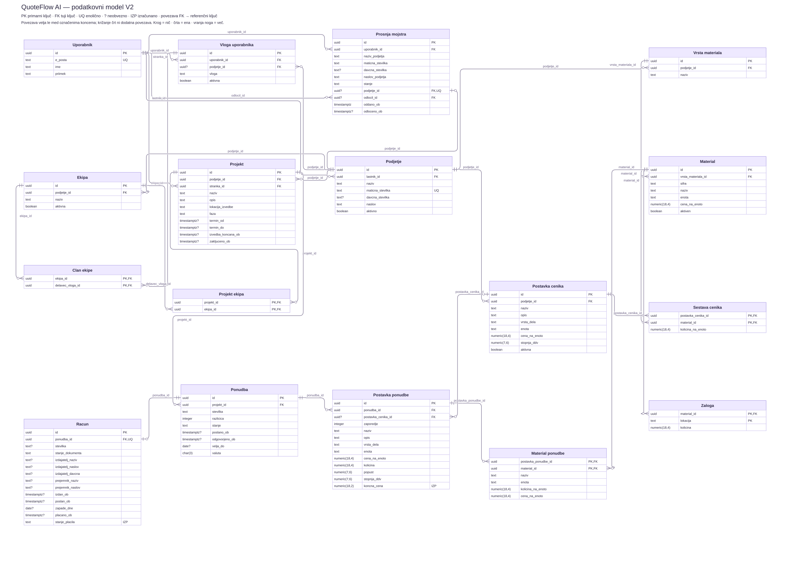

# Podatkovni model

Primarni relacijski model ima **17 tabel** in nadomešča prejšnji model RFQ. Obsega uporabnike, podjetja, projekte, ekipe, cenik, materiale, ponudbe in račune. Stanje uvedbe je v [razvojnih navodilih](razvoj/podatkovni-model.md).

## Poslovna logika

### Uporabniki, vloge in podjetja

Uporabnik ima lahko več vlog hkrati. `admin` in `stranka` veljata globalno, `mojster` in `delavec` pa izključno pri konkretnem podjetju. Po potrditvi registracije uporabnik samodejno dobi vlogo `stranka`. Mojster je lahko tudi delavec svojega ali drugega podjetja, vendar potrebuje ločeno dodelitev. Nobena poslovna vloga ne daje pravic pri drugem podjetju.

Podjetje ima enega lastnika. Lastnik mora imeti aktivno vlogo `mojster` prav pri tem podjetju; lastništvo je povezava na uporabnika, ne peta vloga. Stranka ali delavec lahko odda prošnjo s podatki svojega podjetja. Prošnjo odobri admin. Odobritev v eni transakciji ustvari podjetje, lastništvo in vlogo mojstra. Zavrnitev ne ustvari podjetja ali pravice. Mojster lahko svojemu podjetju doda delavce in kot delavca doda tudi sebe.

### Projekti in ekipe

Projekt pripada enemu podjetju in eni stranki. Ekipa pripada enemu podjetju; uporabnik je njen član prek svoje dodelitve `delavec` pri istem podjetju. Delavec je lahko v več ekipah, ekipa na več projektih, projekt pa ima več ekip. Udeležba delavca pri projektu izhaja iz članstva in dodelitve ekipe; dodatne podvojene povezave delavec–projekt ni.

| Faza oziroma stanje projekta | Poslovni dogodek |
|---|---|
| `pregled` | Nastane projekt in pregleda se zahteva stranke. |
| `ogled` | Potreben je ogled; po potrebi se faza preskoči. |
| `ponudba` | Stranki je poslana prva ponudba. Zavrnitev omogoča novo različico. |
| `termin` | Stranka sprejme ponudbo. |
| `izvedba` | Vnesen je dogovorjeni termin izvedbe. |
| `obracun` | Izvedba je zaključena, račun izdan in poslan stranki. |
| `zakljucen` | Račun je v celoti plačan; zapiše se čas zaključka projekta. |

Projekt hrani `faza` in `zakljuceno_ob`. Njegovo splošno stanje je izpeljano: brez časa zaključka je `v_teku`, sicer `zakljucen`; podvojeni stolpec za isto informacijo ni potreben. Vnos termina označi fazo izvedbe, sam po sebi pa ne potrjuje opravljenega dela.

### Cenik, materiali in zaloga

Cenik hrani ponovno uporabne postavke dela oziroma storitve, npr. »Rušenje estriha«. Materiali so ločeni od storitev: imajo vrsto, šifro, mersko enoto in ceno. Zaloga hrani količino materiala po lokacijah; ključ `(material_id, lokacija)` omogoča isti material na več lokacijah. Podjetje materiala izhaja iz njegove vrste.

`Sestava cenika` povezuje postavko cenika z materiali in njihovo količino za eno enoto dela. Povezava je neobvezna: delo lahko ne zahteva materiala. Na ponudbo se prenesejo finančne vrednosti postavke in njena materialna sestava; zato sprememba cenika ne spremeni poslane ponudbe. `Material ponudbe` ohrani ime, enoto, količino in ceno materiala ob pripravi dokumenta. Ponudba ne rezervira ali samodejno zmanjšuje zaloge.

Cena postavke ponudbe je prodajna cena za dogovorjeno enoto dela. Materialna sestava opisuje potrebne materiale; njihove cene se ne prištevajo še enkrat k prodajni ceni. Če želi mojster material zaračunati posebej, ga prikaže z ločeno postavko. Količina materiala za projekt je `kolicina postavke × kolicina_na_enoto materiala`.

### Ponudbe in računi

Ponudba pripada projektu in vsebuje več postavk. Postavka lahko izhaja iz cenika ali je vnesena ročno. Hrani naziv, opis, vrsto dela, enoto, ceno, količino, popust, stopnjo DDV in izračunano končno ceno. Potek je `osnutek → poslana → sprejeta/zavrnjena`; stranka projekta odloča samo o poslani ponudbi.

Poslana ponudba in njene postavke se ne spreminjajo. Popravek pomeni novo različico. Projekt ima lahko več različic, vendar največ eno sprejeto ponudbo. Račun se sklicuje na to sprejeto, nespremenljivo ponudbo; njegove postavke in zneski izhajajo neposredno iz nje. Ločene kopije enakih postavk računa niso potrebne, saj samostojno spreminjanje vsebine računa ni del opisanega obsega.

Ob sprejemu ponudbe nastane osnutek računa, račun pa se izda in pošlje po končani izvedbi. Dokumentno stanje računa je `osnutek/izdan`. Plačanost se izpelje iz `placano_ob`: izpolnjen čas pomeni `placan`, sicer `neplacan`. Ob evidentiranju celotnega plačila izdanega računa se zaključi projekt. Delna plačila niso vključena.

## Enoten relacijski ER-diagram

[Uredi celoten diagram v draw.io](diagrams/03-podatkovni-model.drawio) · [Odpri SVG v polni velikosti](diagrams/03-podatkovni-model.svg)

Diagram ima **eno stran in 17 tabel**. Vsaka tabela se pojavi enkrat; stolpci so **podatkovni tip | atribut | PK/FK/UQ**. Vsaka povezava povezuje konkretno vrstico FK s konkretno vrstico referenčnega ključa in je označena z imenom FK. Krog pomeni nič, črta eno in vranja noga več. Križanje črt ni povezava: povezave obstajajo samo na označenih koncih pri tabelah.

## Entitete in atributi

`PK` je primarni ključ, `FK` tuji ključ, `UQ` enoličnost, `?` dovoljen NULL in `IZP` izpeljana vrednost. Drugi atributi so obvezni. Samostojni ID so UUID; časovni podatki so `timestamptz`, denar in količine decimalni. `IZP` se samodejno izračuna v bazi in se ne ureja neposredno.

| Entiteta | Atributi |
|---|---|
| `uporabnik` | `id uuid PK`; `e_posta text UQ`; `ime text`; `priimek text` |
| `vloga_uporabnika` | `id uuid PK`; `uporabnik_id uuid FK`; `podjetje_id uuid? FK`; `vloga text`; `aktivna boolean` |
| `podjetje` | `id uuid PK`; `lastnik_id uuid FK`; `naziv text`; `maticna_stevilka text UQ`; `davcna_stevilka text?`; `naslov text`; `aktivno boolean` |
| `prosnja_mojstra` | `id uuid PK`; `uporabnik_id uuid FK`; `naziv_podjetja text`; `maticna_stevilka text`; `davcna_stevilka text?`; `naslov_podjetja text`; `stanje text`; `podjetje_id uuid? FK,UQ`; `odlocil_id uuid? FK`; `oddano_ob timestamptz`; `odloceno_ob timestamptz?` |
| `projekt` | `id uuid PK`; `podjetje_id uuid FK`; `stranka_id uuid FK`; `naziv text`; `opis text`; `lokacija_izvedbe text`; `faza text`; `termin_od timestamptz?`; `termin_do timestamptz?`; `izvedba_koncana_ob timestamptz?`; `zakljuceno_ob timestamptz?` |
| `ekipa` | `id uuid PK`; `podjetje_id uuid FK`; `naziv text`; `aktivna boolean` |
| `clan_ekipe` | `ekipa_id uuid PK,FK`; `delavec_vloga_id uuid PK,FK` |
| `projekt_ekipa` | `projekt_id uuid PK,FK`; `ekipa_id uuid PK,FK` |
| `postavka_cenika` | `id uuid PK`; `podjetje_id uuid FK`; `naziv text`; `opis text`; `vrsta_dela text`; `enota text`; `cena_na_enoto numeric(18,4)`; `stopnja_ddv numeric(7,6)`; `aktivna boolean` |
| `vrsta_materiala` | `id uuid PK`; `podjetje_id uuid FK`; `naziv text` |
| `material` | `id uuid PK`; `vrsta_materiala_id uuid FK`; `sifra text`; `naziv text`; `enota text`; `cena_na_enoto numeric(18,4)`; `aktiven boolean` |
| `zaloga` | `material_id uuid PK,FK`; `lokacija text PK`; `kolicina numeric(18,4)` |
| `sestava_cenika` | `postavka_cenika_id uuid PK,FK`; `material_id uuid PK,FK`; `kolicina_na_enoto numeric(18,4)` |
| `ponudba` | `id uuid PK`; `projekt_id uuid FK`; `stevilka text`; `razlicica integer`; `stanje text`; `poslano_ob timestamptz?`; `odgovorjeno_ob timestamptz?`; `velja_do date?`; `valuta char(3)` |
| `postavka_ponudbe` | `id uuid PK`; `ponudba_id uuid FK`; `postavka_cenika_id uuid? FK`; `zaporedje integer`; `naziv text`; `opis text`; `vrsta_dela text`; `enota text`; `cena_na_enoto numeric(18,4)`; `kolicina numeric(18,4)`; `popust numeric(7,6)`; `stopnja_ddv numeric(7,6)`; `koncna_cena numeric(18,2) IZP` |
| `material_ponudbe` | `postavka_ponudbe_id uuid PK,FK`; `material_id uuid PK,FK`; `naziv text`; `enota text`; `kolicina_na_enoto numeric(18,4)`; `cena_na_enoto numeric(18,4)` |
| `racun` | `id uuid PK`; `ponudba_id uuid FK,UQ`; `stevilka text?`; `stanje_dokumenta text`; `izdajatelj_naziv text?`; `izdajatelj_naslov text?`; `izdajatelj_davcna text?`; `prejemnik_naziv text?`; `prejemnik_naslov text?`; `izdan_ob timestamptz?`; `poslan_ob timestamptz?`; `zapade_dne date?`; `placano_ob timestamptz?`; `stanje_placila text IZP` |

## Celovitost in dostop

- PK/FK zagotavljajo obstoj povezanih zapisov; uporabljeni zapisi se ne brišejo kaskadno. Vloge so enolične za uporabnika in obseg. Lastnik mora ohraniti aktivno vlogo mojstra v svojem podjetju.
- Sestavljeni PK preprečijo podvojena članstva, ekipe projekta in materialne sestave. Enolične so matična številka, različica ponudbe v projektu, zaporedje postavke in račun ponudbe. Šifra materiala ter številka izdanega računa sta enolični znotraj podjetja.
- Članstvo, ekipa projekta, sestava cenika in izvori postavk/materialov ponudbe morajo pripadati istemu podjetju. Poleg FK so potrebna preverjanja, ki preprečijo tudi naknadno premikanje povezanih zapisov med podjetji.
- Stranka vidi svoje projekte in poslane dokumente, delavec dodeljene projekte prek ekip, mojster upravlja svoje podjetje. Admin upravlja uporabnike, podjetja in prošnje. Backend in RLS preverjata sejo, aktivno vlogo ter konkretno podjetje.
- Poslane ponudbe in izdani računi so nespremenljivi. Sprejem ponudbe, nastanek osnutka računa in prehod projekta v `termin` so ena transakcija; enako velja za evidentiranje plačila in zaključek projekta.
- Količine postavk in sestave so pozitivne, zaloga in cene nenegativne. `0 ≤ popust < 1`, `0 ≤ stopnja_ddv ≤ 1`; delež `0.22` pomeni 22 %. Valuta je EUR. `neto = round(kolicina × cena_na_enoto × (1 − popust), 2)`, `ddv = round(neto × stopnja_ddv, 2)`, `koncna_cena = neto + ddv`. Uporablja se decimalna aritmetika in zaokroževanje polovice navzgor.

Model ne vključuje starega RFQ in izbire ponudnikov. [Načrtovani obseg](02-funkcionalnosti-in-obseg.md) poleg osnovnega procesa predvideva AI-pomoč F16–F20, e-pošto F12, priloge F21 in opombe F22; ti postopki še niso izvedeni in lahko zahtevajo dodatne evidence oziroma shrambo. Shema 17 tabel ne predstavlja vseh prihodnjih funkcionalnosti. Evidentiranje delovnih ur ter rezervacije in poraba zaloge ostajajo nadgradnje F23–F24; delna plačila niso vključena.
