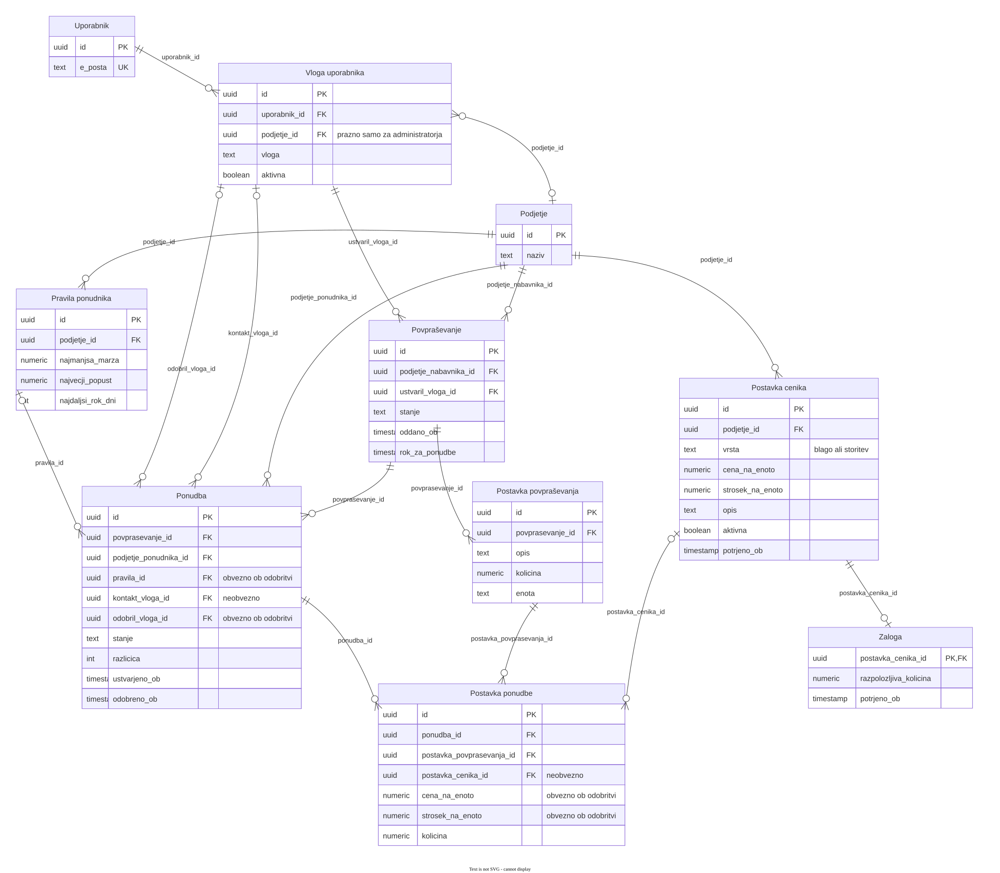

# Podatkovni model QuoteFlow AI

## Osnovna logika

**Uporabnik** je človek s prijavo in e-pošto. **Podjetje** lahko kupuje, prodaja ali oboje. Tabela **Vloga uporabnika** pove, za katero podjetje sme človek delovati kot nabavnik ali ponudnik. Uporabnik ima lahko več takih vlog; lahko je tudi registriran brez članstva in tedaj ne sme poslovno ukrepati. Vloga administratorja je globalna in zato nima podjetja. Agent AI ni uporabnik ali poslovna vloga.

**Povpraševanje (RFQ)** odda uporabnik z vlogo nabavnika za svoje podjetje. Vsebuje eno ali več postavk, opisanih z besedilom, količino in enoto. Za vsako ročno ali samodejno izbrano podjetje ponudnika nastane ena **ponudba** v stanju `povabljena`. Tako povpraševanje lahko dobi več ponudb, posamezna ponudba pa odgovarja na natanko eno povpraševanje. Podjetje ponudnika je neposredno zapisano na ponudbi; ločena tabela za vabilo ni potrebna.

Agent iz aktivnih, potrjenih **postavk cenika** (blaga ali storitev) predlaga postavke ponudbe. Pri blagu preveri tudi **zalogo**, če jo ponudnik vodi; pri storitvi zaloge ni. **Pravila ponudnika** določajo dovoljene marže, popuste in roke. Ponudba kaže na uporabljeno različico pravil. Manjkajoče cene ali stroške mora dopolniti ponudnik; agent jih ne ugiba.

Ponudnik osnutek pregleda, uredi in izrecno odobri. Odobritev se zabeleži s stanjem `odobrena`, dodeljeno vlogo odobritelja in časom. Takrat se ponudba in njene postavke zaklenejo; nabavnik jih vidi šele po odobritvi in nikoli ne vidi internih stroškov. **»Odobrena« pomeni odobritev ponudnika**, ne sprejema ponudbe s strani nabavnika; naročanje ni del tega projekta.

**Primer:** Ana je nabavnica podjetja A in odda povpraševanje za 100 ležajev. Izbrani podjetji B in C dobita vsaka svoj zapis ponudbe za **isto** povpraševanje. Pri B agent preveri potrjeno ceno, pravila in zalogo blaga. Če C ponuja storitev, ima postavko cenika brez zaloge. Ponudbo B lahko odobri samo uporabnik z aktivno vlogo ponudnika pri B.

## Entitete in ključni atributi

`PK` = primarni ključ, `FK` = tuji ključ, `UQ` = enoličnost, `?` = neobvezno. Imena atributov so zaradi tehnične berljivosti zapisana brez šumnikov. Model je uveden v shemi `quoteflow`; SQL-imena tabel in atributov sledijo slovenskim imenom iz tega dokumenta.

| Entiteta | Ključni atributi | Zakaj obstaja |
|---|---|---|
| **Uporabnik** | `id PK`, `e_posta UQ` | Identiteta in prijava v Supabase Auth; poslovnih vlog nima v svoji vrstici. |
| **Podjetje** | `id PK`, `naziv`, `stanje` | Poslovni kupec ali ponudnik. Isto podjetje lahko opravlja obe nalogi. |
| **Vloga uporabnika** | `id PK`, `uporabnik_id FK → Uporabnik`, `podjetje_id? FK → Podjetje`, `vloga`, `aktivna` | `nabavnik` in `ponudnik` zahtevata podjetje; `administrator` ga nima. En uporabnik lahko dobi več vlog, vsaka dodelitev je enolična. |
| **Pravila ponudnika** | `id PK`, `podjetje_id FK → Podjetje`, `najmanjsa_marza`, `najvecji_popust`, `najdaljsi_rok_dni`, `velja_od`, `velja_do?` | Različica poslovnih pravil podjetja; hkrati velja največ ena aktivna različica. |
| **Postavka cenika** | `id PK`, `podjetje_id FK → Podjetje`, `vrsta` (blago/storitev), `opis`, `enota`, `cena_na_enoto`, `strosek_na_enoto`, `dobavni_rok_dni?`, `aktivna`, `potrjeno_ob?` | Ponudnikov vir cene in stroška za blago **ali** storitev. Neaktivna postavka ostane v zgodovini, agent pa je ne uporablja. Ne obstaja posebna entiteta »Izdelek«. |
| **Zaloga** | `postavka_cenika_id PK/FK → Postavka cenika`, `razpolozljiva_kolicina`, `potrjeno_ob` | Neobvezen trenutni podatek samo za blago; storitev nima vrstice zaloge. |
| **Povpraševanje** | `id PK`, `podjetje_nabavnika_id FK → Podjetje`, `ustvaril_vloga_id FK → Vloga uporabnika`, `stanje`, `kraj_dobave?`, `zahtevani_datum?`, `oddano_ob?`, `rok_za_ponudbe?` | Kupčeva zahteva; ustvarjalec mora imeti aktivno vlogo nabavnika pri tem podjetju. Čas oddaje loči osnutek od oddanega RFQ, rok določa, do kdaj ponudnik odgovori. |
| **Postavka povpraševanja** | `id PK`, `povprasevanje_id FK → Povpraševanje`, `opis`, `kolicina`, `enota` | Ena zahtevana vrsta blaga ali storitve, neodvisna od ponudnikovega cenika. |
| **Ponudba** | `id PK`, `povprasevanje_id FK → Povpraševanje`, `podjetje_ponudnika_id FK → Podjetje`, `pravila_id? FK → Pravila ponudnika`, `kontakt_vloga_id? FK → Vloga uporabnika`, `odobril_vloga_id? FK → Vloga uporabnika`, `izvor_izbire`, `razlog_izbire?`, `stanje`, `razlicica`, `ustvarjeno_ob`, `odobreno_ob?`, `velja_do?`, `valuta`, `placilni_pogoji?`, `znesek_skupaj?` | En zapis za izbranega ponudnika skozi celoten potek. `UQ(povprasevanje_id, podjetje_ponudnika_id)`. Čas nastanka omogoča merjenje odziva; kontakt je neobvezen, odobritelj in čas pa obvezna pri stanju `odobrena`. |
| **Postavka ponudbe** | `id PK`, `ponudba_id FK → Ponudba`, `postavka_povprasevanja_id FK → Postavka povpraševanja`, `postavka_cenika_id? FK → Postavka cenika`, `opis`, `kolicina`, `enota`, `cena_na_enoto?`, `strosek_na_enoto?`, `popust`, `dobavni_rok_dni?` | Ponudnikov odgovor na kupčevo postavko. Cena in strošek sta lahko med pripravo neznana, pred odobritvijo pa obvezna. Dogovorjene vrednosti se nato zaklenejo; notranji strošek ni viden nabavniku. |

## ER-diagram

Vsaka povezava je označena z **imenom tujega ključa v podrejeni tabeli**. `||` pomeni natanko eno, `o|` nič ali eno, `o{` nič ali več. V diagramu se podjetje pojavi le enkrat: pri povpraševanju je kupec, pri ponudbi in ceniku ponudnik.

[Odpri diagram v polni velikosti](diagrams/03-podatkovni-model.svg) · [Uredi izvorno datoteko Draw.io](diagrams/03-podatkovni-model.drawio)

## Pravila povezav in stanj

- Vloga je vez med uporabnikom in podjetjem, ne lastnost podjetja. Poslovni vlogi zahtevata podjetje; globalni administrator ga nima. Trojica `(uporabnik_id, podjetje_id, vloga)` je enolična, dodelitev administratorja brez podjetja pa potrebuje ločeno enoličnost. Registriran uporabnik brez aktivne poslovne vloge ne more oddati povpraševanja ali odobriti ponudbe. Administrator sam po sebi ne more odobriti ponudbe.
- `Povpraševanje.ustvaril_vloga_id` mora kazati na aktivnega nabavnika pri `podjetje_nabavnika_id`. Oddano povpraševanje mora imeti vsaj eno postavko in `oddano_ob`; `rok_za_ponudbe`, če je določen, mora biti poznejši od časa oddaje.
- `Ponudba.podjetje_ponudnika_id` se mora razlikovati od kupčevega podjetja pri istem povpraševanju. `kontakt_vloga_id` in `odobril_vloga_id` lahko kažeta samo na aktivnega ponudnika pri tem podjetju. `pravila_id` mora pripadati istemu podjetju.
- Postavka ponudbe mora odgovarjati na postavko **istega** povpraševanja. Če kaže na postavko cenika, mora ta pripadati **istem** podjetju ponudnika. Agent uporabi samo aktivno postavko z `potrjeno_ob`; postavka vrste `storitev` ne sme imeti vrstice zaloge, za blago pa se zaloga preveri, kadar jo ponudnik vodi. Če podatki niso potrjeni ali manjkajo, osnutek zahteva ročni pregled.
- Ob izbiri ponudnika nastane ponudba v stanju `povabljena`; sledijo `osnutek` in po potrebi `v_pregledu`. Ponudnik jo lahko `zavrne` ali `odobri`. Pred odobritvijo mora imeti vsaj eno popolno postavko. Samo `odobrena` ponudba je vidna nabavniku. Zavrnitev ne pomeni kupčeve zavrnitve, temveč odločitev ponudnika, da ponudbe ne izda.
- Ob odobritvi strežniški postopek ponovno preveri aktivno vlogo, aktualno različico pravil, ceno, strošek, maržo, popust in morebitno zalogo; `pravila_id` nastavi na uporabljeno različico. V isti transakciji zapiše odobritelja, čas, skupni znesek in stanje ter zaklene ponudbo in postavke. Tako poznejša sprememba cenika ali zaloge ne spremeni že odobrene ponudbe.
- Nabavnik bere samo odobrene javne podatke ponudbe. RLS loči podjetja, strežniški API ali izrecno omejen pogled pa izloči `strosek_na_enoto`; samo filtriranje vrstic z RLS ne bi skrilo tega stolpca. Pravila, ki primerjajo več tabel, se uveljavijo v transakcijskem postopku oziroma ustreznem sprožilcu.

**Poznejša nadgradnja F10 – Obvestilo:** `id PK`, `ponudba_id FK → Ponudba`, `prejemnik_vloga_id FK → Vloga uporabnika`, `dogodek`, `kanal`, `stanje_dostave`, `kljuc_brez_podvajanja UQ`, `poslano_ob?`. Dogodek razlikuje novo povabilo, osnutek in odobreno ponudbo. Prejemnik mora imeti ustrezno aktivno vlogo pri kupcu ali ponudniku. Obvestilo je ločen zapis o dostavi, ne odločitev o ponudbi; e-pošta vsebuje povezavo do aplikacije, ne cen ali internih stroškov.

## Stanje uvedbe

Migracija `20261027161706_identity_and_permissions.sql` je zamenjala staro poslovno shemo z navedenimi desetimi entitetami. Stare tabele, med njimi `products`, `company_members`, `platform_admins` in `published_quotes`, so odstranjene. Supabase Auth ostaja vir prijavne identitete; `uporabnik` se samodejno usklajuje z `auth.users` brez dodeljevanja poslovnih pravic ob registraciji.

Prijava in administracija podjetij ter vlog sta vključeni v aplikacijo. Preostale poslovne tabele so pripravljene za nadaljnje MVP sklope; uporabniški postopki za RFQ, cenik in ponudbe še niso odprti. Vse tabele imajo RLS, pisanje podjetij in dodelitev pa poteka prek omejenih administratorskih funkcij.
