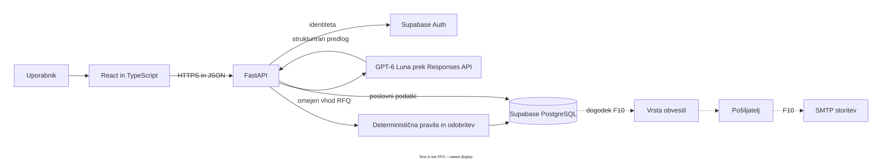

# Arhitektura in tehnološki sklad

## Poslovni tok

1. Nabavnik z aktivno pravico `buyer` odda RFQ za svoje podjetje. Zahteve so prosto opisane; niso vezane na cenik enega ponudnika.
2. Ročna izbira ali sistemsko ujemanje ustvari po eno ponudbo v stanju `povabljena` za vsako registrirano podjetje ponudnika. Neobvezni kontaktni uporabnik mora imeti pri njem aktivno pravico `supplier`.
3. Backend posreduje omejenemu AI-agentu besedilo RFQ in dovoljene podatke potrjenega cenika blaga ali storitev. Agent vrne strukturiran predlog razumevanja in ujemanja. Manjkajoče ali dvoumne podatke označi za pregled.
4. Backend za vsakega izbranega ponudnika pripravi ločen osnutek. Programska pravila preverijo ceno, strošek, maržo, morebitno zalogo, popust in rok; agent teh vrednosti ne potrjuje.
5. Ponudnik osnutek popravi, zavrne ali odobri. Ob odobritvi sistem še enkrat preveri pravice in izračune ter v eni transakciji zabeleži odobritelja, čas in stanje `odobrena` ter zaklene ponudbo s postavkami. Nabavnik vidi le odobreno ponudbo brez internih stroškov.
6. Obvestila v aplikaciji in po e-pošti so F10, poznejša funkcionalnost. Nastanejo iz zabeleženega dogodka in ne določajo veljavnosti odobritve.

## Deli sistema in komunikacija

[Odpri diagram v polni velikosti](diagrams/04-arhitektura.svg) · [Uredi izvorno datoteko Draw.io](diagrams/04-arhitektura.drawio)

API pri vsakem zahtevku preveri uporabnika, aktivno dodelitev pravice in podjetje. PostgreSQL RLS je dodatna meja za branje podatkov med podjetji; za pisanje veljajo ozki strežniški postopki. AI uporablja le orodja za branje potrjenih podatkov, nima pravice odobritve ali pošiljanja e-pošte. SMTP-pošiljatelj dela šele po uspešnem zapisu poslovnega dogodka; ob napaki obvestilo poskusi znova brez podvojitve sporočila. E-pošta vsebuje le obvestilo in povezavo na prijavo v aplikacijo.

## Tehnološki sklad

| Del | Izbira | Razlog |
|---|---|---|
| Spletni vmesnik | React, TypeScript, Vite | Obrazci in pregled stanj z nadzorovanimi podatkovnimi tipi. |
| Strežniški del | Python, FastAPI | En API za pravice, poslovna pravila in integracijo modela. |
| Podatki in identiteta | Supabase PostgreSQL, Supabase Auth | Relacije, transakcije, RLS in en vir prijavne identitete. |
| AI-agent | [OpenAI GPT-6 Luna](https://developers.openai.com/api/docs/models/gpt-6-luna), Responses API | Omejena analiza besedila; model podpira klicanje funkcij in strukturiran izhod. |
| E-pošta F10 | Vrsta obvestil, ločen pošiljatelj, SMTP | Dostava se lahko ponovi, ne da bi vplivala na odobreno ponudbo. |
| Lokalni razvoj | Docker Compose, Supabase CLI, pytest | Ponovljiv zagon, migracije in preverjanje pravil. |

## Arhitekturne odločitve

- **En poslovni proces za oba načina izbire:** oba ustvarita ponudbo v stanju `povabljena`; razlog in izvor izbire sta zapisana na njej. Ločena tabela vabil ni potrebna.
- **Ena tabela za dodelitve pravic:** uporabnik lahko pri različnih podjetjih opravlja različni nalogi; globalni administrator nima lažnega članstva v podjetju.
- **Ena ponudba od izbire do odobritve:** stanje in zapis odobritve sta na ponudbi. Ob odobritvi se ponudba in njene postavke zaklenejo; nabavnik dobi samo dovoljena javna polja.
- **AI predlaga, program preveri, človek odobri:** model ne določa poslovno zavezujočih cen ali zalog.
- **E-pošta ni transakcija odobritve:** odobrena ponudba ostane veljavna tudi ob začasni napaki SMTP; pošiljanje in stanje dostave se vodita ločeno.

Podrobne entitete, ključi in povezave so v [podatkovnem modelu](03-podatkovni-model.md). To je **ciljna arhitektura**. Trenutno ogrodje vsebuje demonstracijski kalkulator in starejšo shemo; opisani RFQ-proces, agent, odobritev ter e-pošta še niso v celoti implementirani. Spletno odkrivanje dodatnih ponudnikov in dovoljeno pridobivanje javnih podatkov ostajata nadgradnji; tak podatek ni potrjena ponudba.
