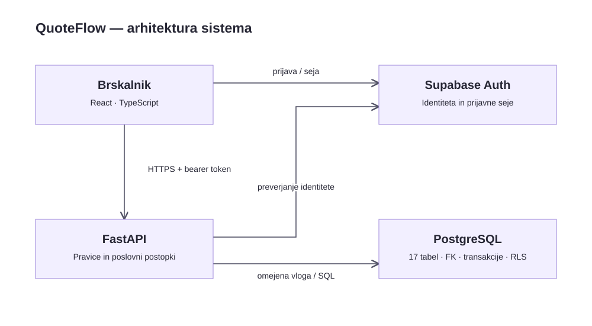

# Arhitektura in tehnološki sklad

## Deli sistema

[Uredi v draw.io](diagrams/04-arhitektura.drawio) · [Odpri v polni velikosti](diagrams/04-arhitektura.svg)

Brskalnik uporablja Supabase za prijavo, poslovna dejanja pa izvaja prek FastAPI. API preverja identiteto, aktivno sejo, vlogo in podjetje. PostgreSQL hrani [17 povezanih tabel](03-podatkovni-model.md); omejitve in RLS dodatno varujejo povezave ter dostop. Migracije so edini vir sprememb sheme.

## Pravice in poslovni proces

`admin` in `stranka` sta globalni vlogi, `mojster` in `delavec` sta vezani na podjetje. Lastnik podjetja mora biti njegov aktivni mojster. Pravica mojstra pri enem podjetju ne daje pravic pri drugem. Delavec vidi projekte prek svojih ekip, stranka samo svoje projekte in dovoljene dokumente.

Projekt poteka od pregleda/ogleda prek ponudbe, termina in izvedbe do obračuna in plačila. Poslane ponudbe in izdani računi ohranijo podatke dokumenta; poslovni dogodki s povezanimi spremembami se izvajajo transakcijsko. Izračuni uporabljajo decimalne vrednosti, ne jezikovnega modela.

## Tehnologije in razlogi

| Del | Izbira in razlog |
|---|---|
| Frontend | React, TypeScript, Vite: obrazci, pregledi in preverljivi tipi; organizacija po funkcionalnostih. |
| Backend | Python, FastAPI: enotna meja za pravice in poslovne postopke, validacija zahtevkov. |
| Podatkovna baza | Supabase PostgreSQL: relacije, transakcije, FK, omejitve in RLS. |
| Identiteta | Supabase Auth: upravljana prijava; poslovne pravice so ločene od prijavne identitete. |
| Lokalni razvoj | Docker Compose za frontend/backend, oddaljena baza Supabase; pytest, Vitest in Playwright za preverjanje. |

## Načrtovane razširitve

Diagram prikazuje osnovno arhitekturo. [Obseg](02-funkcionalnosti-in-obseg.md) določa 7 MVP funkcionalnosti in nadaljnji razvoj; uvedba sheme še ne pomeni izvedenih uporabniških postopkov.

- **AI-pomoč F16–F20:** backend bo omejil dostop na dovoljene podatke projekta in njegovega podjetja. Agent bo predlagal analizo, vsebino osnutka ali povzetek; mojster predloge pregleda. Cene, DDV, količine in zalogo preverja deterministična programska logika. AI ne objavlja dokumentov, ne sprejema ponudb in ne spreminja faz projekta; manjkajoče podatke označi, ne ugiba. Ponudnik LLM, model in izvedba omejenih orodij zahtevajo odločitev pred implementacijo.
- **E-pošta F12:** po poslovnem dogodku bo backend sprožil obvestilo prek izbranega ponudnika. Dostava in ponovni poskusi potrebujejo dodatno evidenco; e-pošta ni pogoj za oddajo ponudbe v aplikaciji v MVP F5.
- **Priloge F21 in opombe F22:** zahtevajo dodatno shrambo oziroma tabele in preverjanje dostopa. Interne opombe morajo ostati ločene od vsebine za stranko.

Te razširitve še niso uvedene. Prvotni RFQ in samodejno iskanje ponudnikov nista del novega procesa. Lokalni zagon je v [README](../README.md), stanje izvedbe pa v [razvojnih navodilih](razvoj/podatkovni-model.md).
