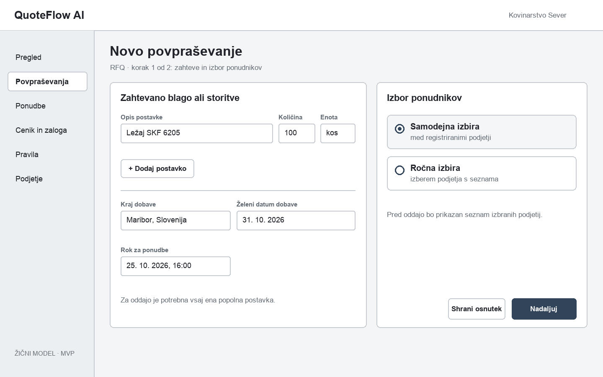
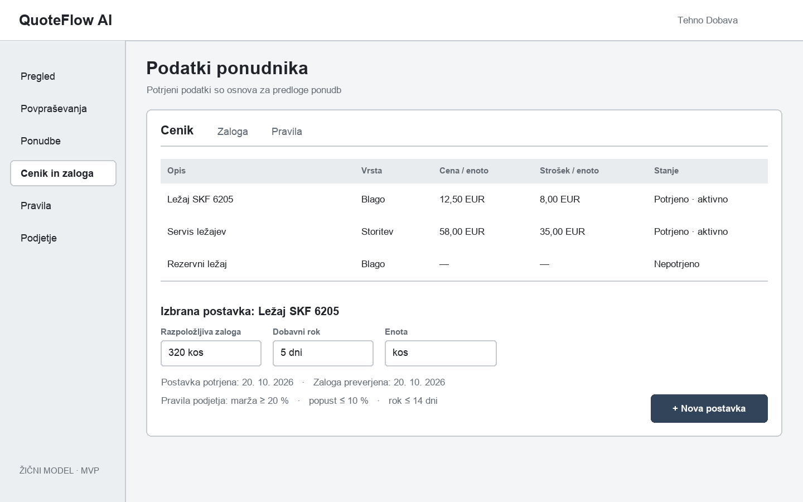
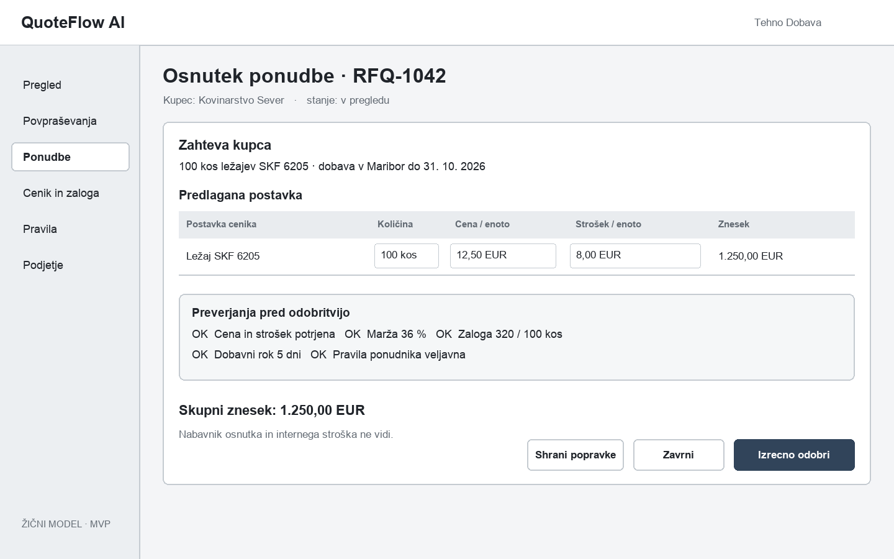
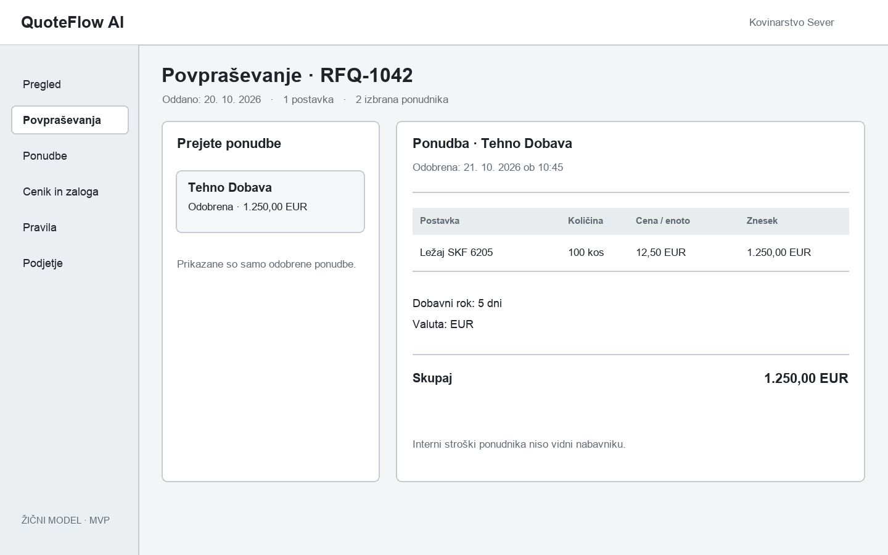

# Žični modeli aplikacije

Štiri skice prikazujejo osnovni videz in zaporedje opravil v MVP. Gre za žične modele, ne za že implementirane zaslone. Podatki v skicah so primeri.

## 1. Novo povpraševanje

Nabavnik vnese postavko, dobavne zahteve in rok ter izbere samodejni ali ročni način izbire ponudnikov. »Nadaljuj« vodi do pregleda izbora pred oddajo. **Povezano:** US-06–US-08 (F3, F4).

## 2. Podatki ponudnika

Ponudnik pregleduje cenik blaga in storitev, stanje potrditve, morebitno zalogo in veljavna pravila podjetja. Nepotrjena postavka ni vir za samodejni osnutek. **Povezano:** US-03–US-05 (F2).

## 3. Pregled osnutka ponudbe

Ponudnik primerja kupčevo zahtevo s predlagano postavko, vidi interna preverjanja in lahko osnutek popravi, zavrne ali izrecno odobri. Ta zaslon ni dostopen nabavniku. **Povezano:** US-09–US-12 (F5, F6).

## 4. Odobrena ponudba za nabavnika

Nabavnik vidi samo odobrene ponudbe za svoj RFQ. Prikazane so dogovorjene postavke, znesek in dobavni rok; notranji stroški in osnutki ponudnika niso prikazani. **Povezano:** US-13 (F7).
