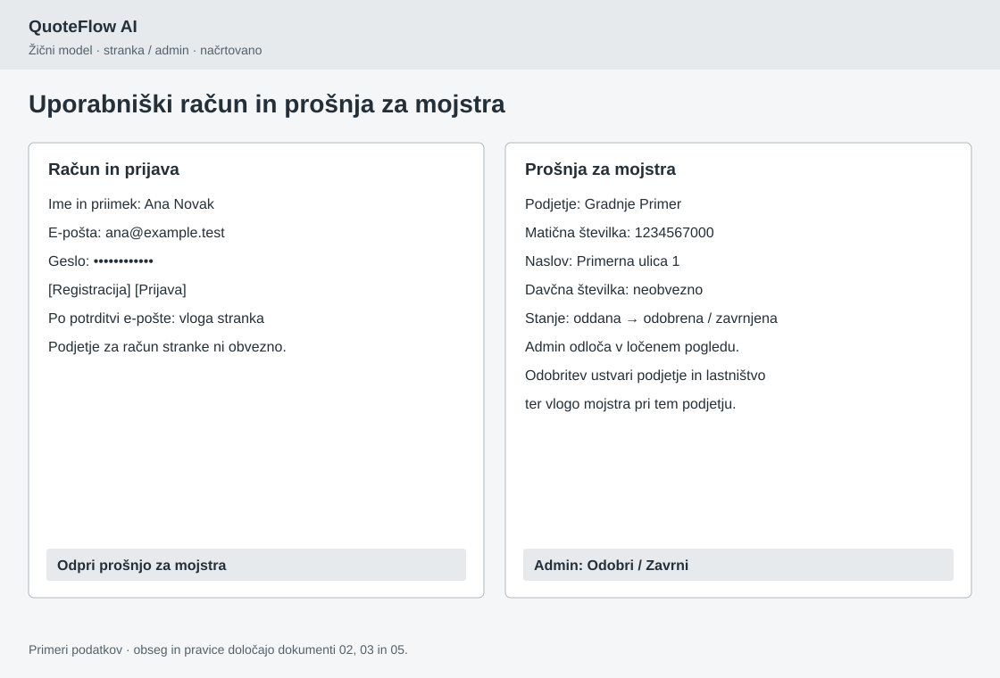
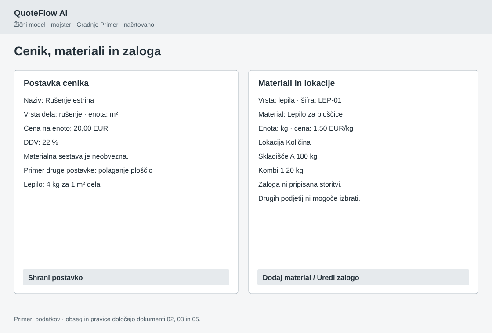
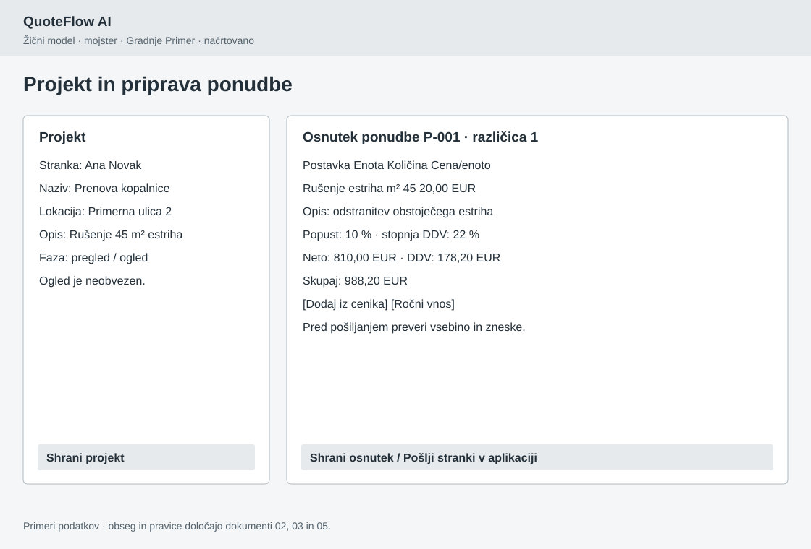
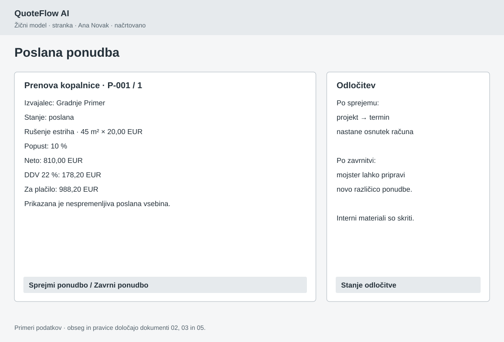
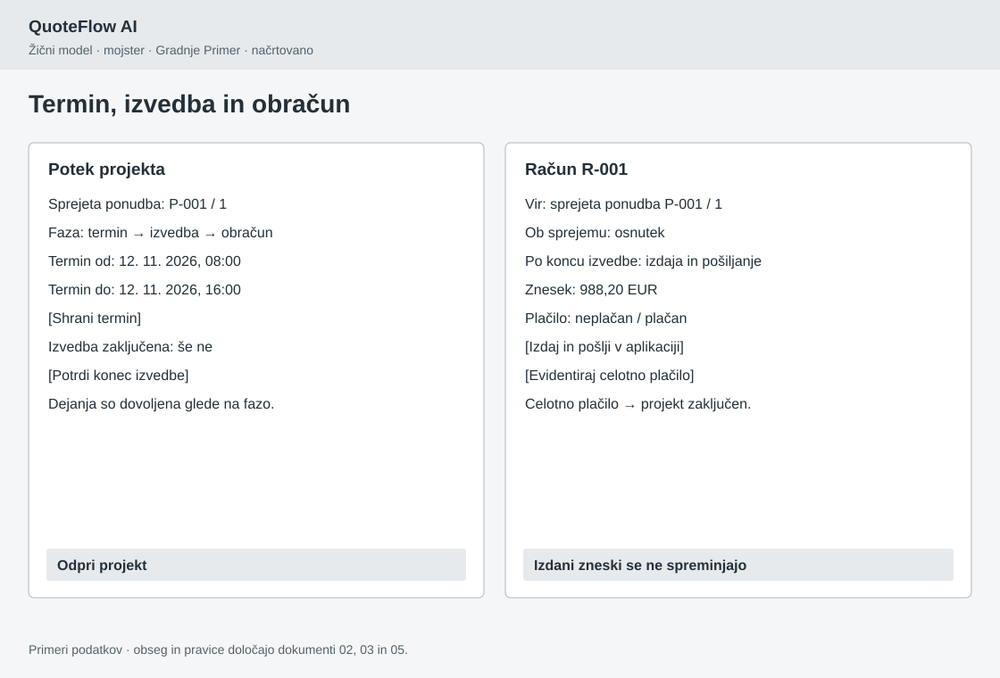

# Žični modeli aplikacije

Skice prikazujejo načrtovani MVP iz [dokumenta 02](02-funkcionalnosti-in-obseg.md), ne že izvedenih zaslonov. Podatki so primeri. Oznake US se nanašajo na [trenutne uporabniške zgodbe](05-uporabniske-zgodbe.md).

## 1. Račun in prošnja za mojstra — F1, US-01

Registracija in prijava ter prošnja s podatki podjetja. Admin prošnjo obravnava v svojem pogledu; odobritev hkrati ustvari podjetje, lastništvo in vlogo mojstra. Stranka za registracijo ne potrebuje podjetja.

## 2. Cenik, materiali in zaloga — F2, US-02

Mojster ureja storitve, neobvezno materialno sestavo ter materiale in zalogo po lokacijah samo svojega podjetja.

## 3. Projekt in osnutek ponudbe — F3–F4, US-03–US-04

Mojster izbere obstoječo stranko, opiše projekt ter pripravi postavke iz cenika ali ročno. Sistem izračuna popust, DDV in končni znesek; pošiljanje stranki je izrecno dejanje.

## 4. Odločitev stranke — F5, US-05

Stranka vidi svojo poslano ponudbo brez internih materialov in jo sprejme ali zavrne. Sprejem ustvari osnutek računa in omogoči določitev termina; vsebina poslane ponudbe ostane zaklenjena.

## 5. Izvedba in račun — F6–F7, US-06–US-07

Mojster določi termin, potrdi končano izvedbo, izda račun ter ročno evidentira celotno plačilo. Prehodi sledijo [podatkovnemu modelu](03-podatkovni-model.md). V MVP sta ponudba in račun dostopna v aplikaciji; e-pošta je poznejša F12.

AI, ekipe in druge funkcionalnosti po MVP v teh skicah niso prikazani. Stare slike `01`–`04` v mapi `wireframes/` so zgodovinske skice prejšnjega RFQ-obsega in ne določajo trenutnega načrta.
